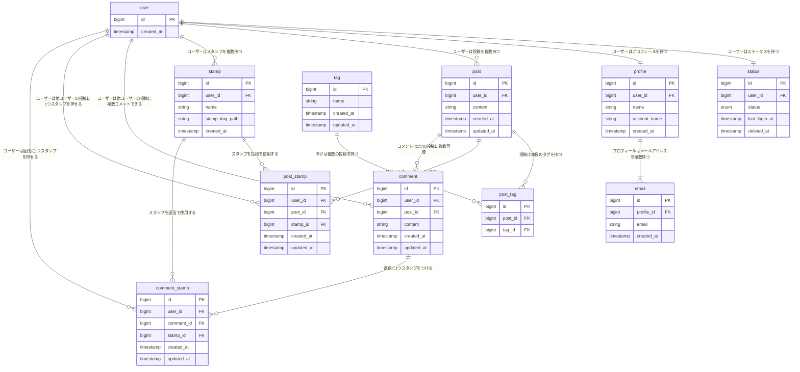

## ER図(mermaid)

## テーブル定義

テーブル：user
| カラム名 | データ型 | NULL | キー | 初期値 | AUTO INCREMENT |
| ---- | ---- | ---- | ---- | ---- | ---- |
| id | bigint | NOT NULL | PRIMARY | | YES |
| created_at | timestamp | NOT NULL |  |  |  |

テーブル：status
| カラム名 | データ型 | NULL | キー | 初期値 | AUTO INCREMENT |
| ---- | ---- | ---- | ---- | ---- | ---- |
| id | bigint | NOT NULL | PRIMARY | | YES |
| user_id | bigint | NOT NULL |  |  |  |
| status | enum | NOT NULL |  | "仮登録" |  |
| last_login_at | timestamp |  |  |  |  |
| deleted_at | timestamp | |  |  |  |
enum：{"仮登録", "本登録", "退会済み"}
外部キー制約：user_id に対して、user テーブルの id カラムから設定

テーブル：profile
| カラム名 | データ型 | NULL | キー | 初期値 | AUTO INCREMENT |
| ---- | ---- | ---- | ---- | ---- | ---- |
| id | bigint | NOT NULL | PRIMARY | | YES |
| user_id | bigint | NOT NULL |  |  |  |
| name | string | NOT NULL |  |  |  |
| account_name | string | NOT NULL |  |  |  |
| created_at | timestamp | NOT NULL |  |  |  |
ユニークキー制約：account_name カラムに対して設定
外部キー制約：user_id に対して、user テーブルの id カラムから設定

テーブル：email
| カラム名 | データ型 | NULL | キー | 初期値 | AUTO INCREMENT |
| ---- | ---- | ---- | ---- | ---- | ---- |
| id | bigint | NOT NULL | PRIMARY | | YES |
| profile_id | bigint | NOT NULL |  |  |  |
| email | string | NOT NULL |  | | |
| created_at | timestamp | NOT NULL |  |  |  |
ユニークキー制約：email カラムに対して設定
外部キー制約：profile_id に対して、profile テーブルの id カラムから設定

テーブル：post
| カラム名 | データ型 | NULL | キー | 初期値 | AUTO INCREMENT |
| ---- | ---- | ---- | ---- | ---- | ---- |
| id | bigint | NOT NULL | PRIMARY | | YES |
| user_id | bigint | NOT NULL |  |  |  |
| content | text | NOT NULL |  |  |  |
| created_at | timestamp | NOT NULL |  |  |  |
| updated_at | timestamp | NOT NULL |  |  |  |
外部キー制約：user_id に対して、user テーブルの id カラムから設定

テーブル：tag
| カラム名 | データ型 | NULL | キー | 初期値 | AUTO INCREMENT |
| ---- | ---- | ---- | ---- | ---- | ---- |
| id | bigint | NOT NULL | PRIMARY | | YES |
| name | string | NOT NULL |  |  |  |
| created_at | timestamp | NOT NULL |  |  |  |
| updated_at | timestamp | NOT NULL |  |  |  |

テーブル：post_tag
| カラム名 | データ型 | NULL | キー | 初期値 | AUTO INCREMENT |
| ---- | ---- | ---- | ---- | ---- | ---- |
| id | bigint | NOT NULL | PRIMARY | | YES |
| post_id | bigint | NOT NULL |  |  |  |
| tag_id | bigint | NOT NULL |  |  |  |
外部キー制約：post_id に対して、post テーブルの id カラムから設定
外部キー制約：tag_id に対して、tag テーブルの id カラムから設定

テーブル：stamp
| カラム名 | データ型 | NULL | キー | 初期値 | AUTO INCREMENT |
| ---- | ---- | ---- | ---- | ---- | ---- |
| id | bigint | NOT NULL | PRIMARY | | YES |
| user_id | bigint | NOT NULL |  |  |  |
| name | string | NOT NULL |  |  |  |
| stamp_img_path | string | NOT NULL |  |  |  |
| created_at | timestamp | NOT NULL |  |  |  |
外部キー制約：user_id に対して、user テーブルの id カラムから設定

テーブル：comment
| カラム名 | データ型 | NULL | キー | 初期値 | AUTO INCREMENT |
| ---- | ---- | ---- | ---- | ---- | ---- |
| id | bigint | NOT NULL | PRIMARY | | YES |
| user_id | bigint | NOT NULL |  |  |  |
| post_id | bigint | NOT NULL |  |  |  |
| content | string | NOT NULL |  |  |  |
| created_at | timestamp | NOT NULL |  |  |  |
| updated_at | timestamp | NOT NULL |  |  |  |
外部キー制約：user_id に対して、user テーブルの id カラムから設定
外部キー制約：post_id に対して、post テーブルの id カラムから設定

テーブル：post_stamp
| カラム名 | データ型 | NULL | キー | 初期値 | AUTO INCREMENT |
| ---- | ---- | ---- | ---- | ---- | ---- |
| id | bigint | NOT NULL | PRIMARY | | YES |
| user_id | bigint | NOT NULL |  |  |  |
| post_id | bigint | NOT NULL |  |  |  |
| stamp_id | bigint | NOT NULL |  |  |  |
| created_at | timestamp | NOT NULL |  |  |  |
| updated_at | timestamp | NOT NULL |  |  |  |
外部キー制約：user_id に対して、user テーブルの id カラムから設定
外部キー制約：post_id に対して、post テーブルの id カラムから設定
外部キー制約：stamp_id に対して、stamp テーブルの id カラムから設定

テーブル：comment_stamp
| カラム名 | データ型 | NULL | キー | 初期値 | AUTO INCREMENT |
| ---- | ---- | ---- | ---- | ---- | ---- |
| id | bigint | NOT NULL | PRIMARY | | YES |
| user_id | bigint | NOT NULL |  |  |  |
| comment_id | bigint | NOT NULL |  |  |  |
| stamp_id | bigint | NOT NULL |  |  |  |
| created_at | timestamp | NOT NULL |  |  |  |
| updated_at | timestamp | NOT NULL |  |  |  |
外部キー制約：user_id に対して、user テーブルの id カラムから設定
外部キー制約：comment_id に対して、comment テーブルの id カラムから設定
外部キー制約：stamp_id に対して、stamp テーブルの id カラムから設定
